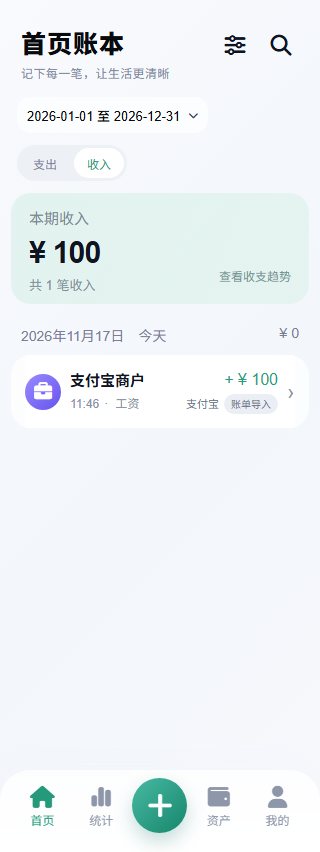
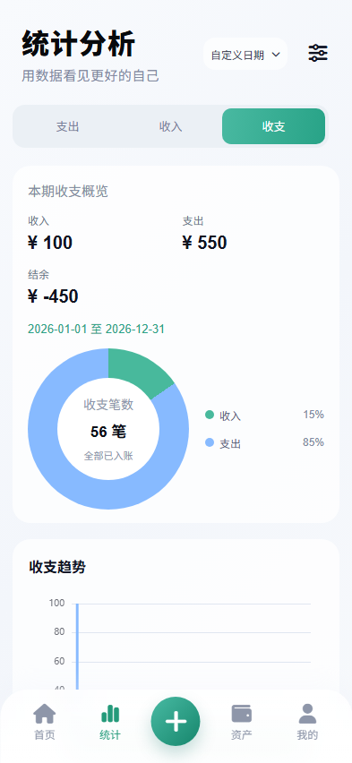

  

<h1 align="center">有数 · Youshu</h1>

<strong>每笔清楚，心中有数。</strong>

支付后自动识别记账，漏记时摇一摇补录。识别、账本和统计都在本机完成，无需账号或服务器。

Android 11+ · 离线 OCR · 本地账本 · GPL-3.0-only

<a href="https://github.com/MisterGaohohoho/youshu-ledger/releases">下载本 Fork APK</a> · <a href="https://github.com/MisterGaohohoho/youshu-ledger/actions/workflows/android.yml">构建与测试</a>

本 Fork 基于 [AldenHe/huayoupu-ledger](https://github.com/AldenHe/huayoupu-ledger)，已同步至上游 `ea07c243`（0.5.114-v6）。新增 [Personal-Bill](https://github.com/MisterGaohohoho/Personal-Bill) 月报、年报与平台账单分析的离线适配，直接使用有数的本地账本。当前版本为 **0.5.120-youshu.1**，支持应用内检查和下载更新。

在 **我的 → 账单与备份 → 导入账单** 选择文件，自动识别微信、支付宝、洁账 XLSX、通用 CSV 和钱迹格式。首页与统计页共用 **按月 / 按年 / 全部 / 自定义** 时间范围及支付渠道、报销筛选。洁账导入正常计入总账和统计，不单列来源筛选项。账单、分类、退款、报销和账户余额共用原有记账数据，详情编辑后同步刷新。[使用说明与适配范围](.github/OFFLINE_BILLS.md)

本 Fork 使用独立长期签名，与原作者 APK 签名不同。切换前请导出完整备份，再卸载原版、安装本 Fork 并恢复备份；已安装本 Fork 0.5.115-offline.1 的用户可以直接覆盖升级；后续本 Fork 版本沿用同一签名。

## 首页收支与版本更新

首页可切换「收支／支出／收入」，收支模式同时显示两类账单、收入、支出和结余。日期与支付渠道筛选继续生效，全选覆盖未加载的分页记录。

「我的 → 版本更新」仅在主动检查或下载时联网；账单、账户、OCR 图片与统计仍在本机处理。下载完成后验证签名与完整性，由系统确认安装。首次需手动覆盖安装带更新功能的版本。构建与签名发布配置见 [.github/UPDATE_RELEASES.md](.github/UPDATE_RELEASES.md)。

## 能做什么

- **支付自动记账**：识别受支持的微信、支付宝支付成功页，自动记录支出。
- **摇一摇与截图补记**：打开单笔账单详情摇一摇，或导入已有截图。
- **离线识别与商户图标**：提取金额、商户、时间与订单号，自动裁剪商户 Logo 或头像。
- **退款与账单核对**：记录原付、已退与实付金额，保留截图和识别原文，支持编辑、去重与删除撤销。
- **账本、预算与统计**：手动记收支、自定义分类、搜索账单，查看月度预算、分类占比及跨月、跨年收支趋势。
- **标签与待报销**：给账单添加标签、标记待报销，按日期和条件生成账单汇总，导出 PNG、Excel 或 PDF 与图片材料包。
- **账户与余额联动**：管理银行卡、微信、支付宝及现金账户；账单关联账户后自动调整余额，支持通用默认账户和微信、支付宝各自的默认账户。
- **灵动岛与记账结果卡片**：支持的系统可通过灵动岛/实时通知衔接结果卡片，直接选择本笔支出的付款账户、标记是否待报销；其他环境直接显示完整结果卡片。
- **备份与迁移**：完整 ZIP 备份恢复、CSV 导入导出，支持钱迹模板。

## 哪些场景可以记账？

| 场景 | 当前支持方式 |
| --- | --- |
| **微信扫码付款、商户付款** | 展示受支持的微信支付成功页时，自动识别记账。 |
| **微信转账** | 支持付款方的转账成功页；不要求对方先确认收款。 |
| **支付宝扫码付款、商户付款、转账** | 展示受支持的支付宝支付或转账成功页时，自动识别记账。 |
| **外卖、购物等第三方 App 拉起微信 / 支付宝付款** | 返回受支持的微信 / 支付宝成功页时，同样可以自动记账。 |
| **地铁、公交等出行扣费** | 可以记账；展示受支持的支付成功页时自动记录，没有成功页的扣费可打开单笔账单详情摇一摇补录。 |
| **协议代扣、历史账单、未展示成功页的付款** | 打开可读取的单笔账单详情摇一摇，或导入截图、手动补记；不保证后台自动采集。 |
| **微信红包** | **暂不支持自动识别记账。** |

密码、验证、系统禁止截图或无法读取的页面会跳过；收款、红包领取和聊天消息不属于自动支出采集范围。[完整覆盖范围](.github/REFERENCE.md#自动记账覆盖范围)

## 版本更新

[0.5.120-youshu.1 更新说明](.github/RELEASE_NOTES.md)

## 界面预览

以下为合成账单的浏览器预览，保留原有薄荷绿、白色界面；不代表物理手机验收结果。

| 首页账本（320px，大字体） | 统计页（393px） |
| :---: | :---: |
|  |  |

## 技术实现

### 为什么选择 PP-OCRv6 Tiny？

支付账单识别更关心金额、订单号与退款状态，中文长文本跑分不能直接代表记账效果。我们用同一批 **19 张图片**（13 张授权真实截图、6 张合成边界图），在同一解析器下比较了 ML Kit Chinese、PP-OCRv5 mobile 与 PP-OCRv6 tiny。

V6 Tiny 的检测与识别权重合计约 **5.95 MiB**，V5 mobile 约 **20.37 MiB**。进一步制作独立单引擎研究包，比较实际体积和账单字段：

| 历史同图测试 | V6 Tiny 精简版 | ML Kit Chinese |
| --- | ---: | ---: |
| 真实支出最终金额正确 | 10/10 | 9/10 |
| 最终订单号精确匹配 | 7/7 | 6/7 |
| 暖态 OCR 中位数 | 464 ms | 1,140 ms |
| ARM64 独立研究 APK | 20.44 MiB | 13.94 MiB |

我们选择 V6 Tiny，是看重这批支付账单中的字段结果、响应速度与可裁剪的本地运行库，同时接受比 ML Kit 更大的包体。**耗时来自 API 30 x86_64 模拟器，包体来自 ARM64 研究包；样本较小，不代表真机完整记账延迟或普遍准确率。** 上表 V6 使用历史默认内存池，当前应用采用下述低保留内存策略。完整口径与原始摘要哈希见[选型数据](.github/benchmarks/ocr-selection.json)。

### 为什么还要针对 OCR 调优？

通用 OCR 输出的是文字和坐标，记账还要解决“哪个数字是实付、哪个时间是付款时间、退款如何计算”，并控制后台内存与安装体积。当前使用上游固定模型权重，做的是**工程与解析调优，未进行模型权重微调训练**。

- **缩小运行库**：按 V6 模型生成算子配置、裁剪 ONNX Runtime 与 OpenCV 模块，结合单 ABI、R8 和资源裁剪；历史独立研究包从 53.48 MiB 降至 20.44 MiB，保留模型精度和中文词典。
- **降低请求间内存保留**：关闭 CPU arena，串行执行解码、OCR 与图标裁剪，排队请求只保留压缩数据，每次结束释放会话和图片。历史换序测试的暖态中位耗时由约 453–469 ms 增至 578–586 ms，换取更低的请求结束后内存占用；这些不是当前应用峰值内存或完整延迟。
- **按账单语义解析**：结合文字坐标区分实付、优惠、原付与已退，处理装饰符号、退款标签和发货时间干扰；金额有冲突时保留校验，避免猜数入账。
- **同图提取商户图标**：利用商户文字与几何位置裁剪 Logo / 头像，生成 128 × 128 图标，在 PNG 与无损 WebP 中选择更小文件；无法可靠定位时使用默认图标。

运行库来源、固定版本、构建方式与修改声明见[OCR 运行库说明](third_party/ocr-runtime/README.md)，详细测试方法见[OCR 调优与回归](.github/REFERENCE.md#ocr-选型调优与测试)。

### 无障碍“破限”：让微信支付成功页可读

部分微信支付成功页在普通无障碍服务下只返回空根节点，单纯补读取 flags 仍然无效。我们做过同一真机成功页的只读 **A→B→A** 对照：保持诊断逻辑、权限与 flags 相同，仅更换服务完整类名，普通入口的有效采样均为 **1 个空节点**，兼容入口的 8 次采样均读到 **32 个节点**及“支付成功”“完成”，换回后再次为空。

当前使用沿用 `SelectToSpeakService` 完整类名的[兼容入口](app/src/main/java/com/google/android/accessibility/selecttospeak/SelectToSpeakService.kt)，内部继承有数自己的识别服务；系统中仍显示“有数 · 页面识别”，`isAccessibilityTool=false`。这项适配未引入 Google 代码或系统权限；微信内部判断机制并未公开，对照结果只证明已测环境中的类名差异有效。

支付成功页到本地账本的流程为：

1. **事件触发检查**：只检查用户开启的应用，合并窗口事件，读取可见文字与内容描述；有界重试处理页面刚切换、节点迟到和深层容器。
2. **确认后取图**：识别明确成功状态和唯一有效金额，截图前重新核对窗口与支付身份。Android 14+ 使用指定窗口截图，旧系统采集后再次核对窗口。
3. **离线识别入账**：本地 OCR 补足商户、时间和订单号，校验并去重；已取得的图片排队处理，离开成功页后仍可完成。

密码、可编辑或不可读页面会跳过，系统安全窗口的截图限制仍然生效。无需 Root、Hook、短信或通知监听；覆盖范围随微信 / 支付宝版本及系统变化。节点恢复后仍要满足成功页检查，不能仅凭容器类名触发截图。实现与验证范围见[无障碍兼容说明](.github/REFERENCE.md#微信成功页的兼容入口与验证)。

## 开始使用

1. 从 [最新 Release](https://github.com/MisterGaohohoho/youshu-ledger/releases) 下载 `arm64-v8a.apk` 并安装，在「我的」开启微信 / 支付宝自动识别或摇一摇，按引导完成授权。
2. 在支持的支付成功页完成自动记账；漏记时用摇一摇、截图导入或手动补记。
3. 回到账本核对记录；换机或卸载前，从「账单与备份」导出完整备份。

自动识别目前记录支出，覆盖范围取决于支付页面与系统版本。识别和数据保存在本机；账户初始余额由你填写，关联账单后随收支调整，不连接银行同步余额。

[使用说明与常见问题](.github/REFERENCE.md#常见问题) · [源码构建](.github/REFERENCE.md#从源码构建) · [参与贡献](CONTRIBUTING.md) · [安全反馈](SECURITY.md)

项目采用 [GPL-3.0-only](LICENSE)；第三方组件及素材声明见 [NOTICE.md](NOTICE.md)。

## 社区交流

[LINUX DO](https://linux.do/) · 真诚、友善、团结、专业。欢迎佬友交流使用体验、反馈问题，一起改进有数。

## 导入记录与截图管理

- **我的 → 账单与备份 → 导入记录**：查看文件导入结果，分页查看本次新增账单，按批次删除并在 10 秒内整批撤销。重复跳过的账单和仅更新退款信息的原账单不在删除范围内；账户与分类保留。仅从本版本起记录批次，批次随完整备份恢复，已有本地账单不会被恢复的批次接管。
- **我的 → 截图管理**：查看占用并设置 50～5120 MiB 的上限，默认 500 MiB。保存或立即清理前显示预计清理量；旧账单的图片也可能被清理，但账单数据、商户图标和相册原图保留。正在识别、排队和撤销期图片暂时保护，可能短时超限。
- 完整 ZIP 备份支持最大 6 GiB 解压内容，图片逐张处理；仍校验单文件大小、附件数量、哈希与路径。大备份导入需要足够的本机临时空间。旧 JSON / ZIP 备份继续可读。
